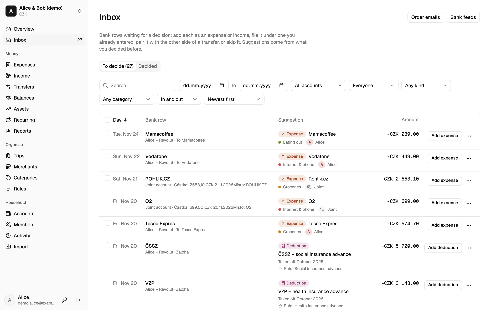
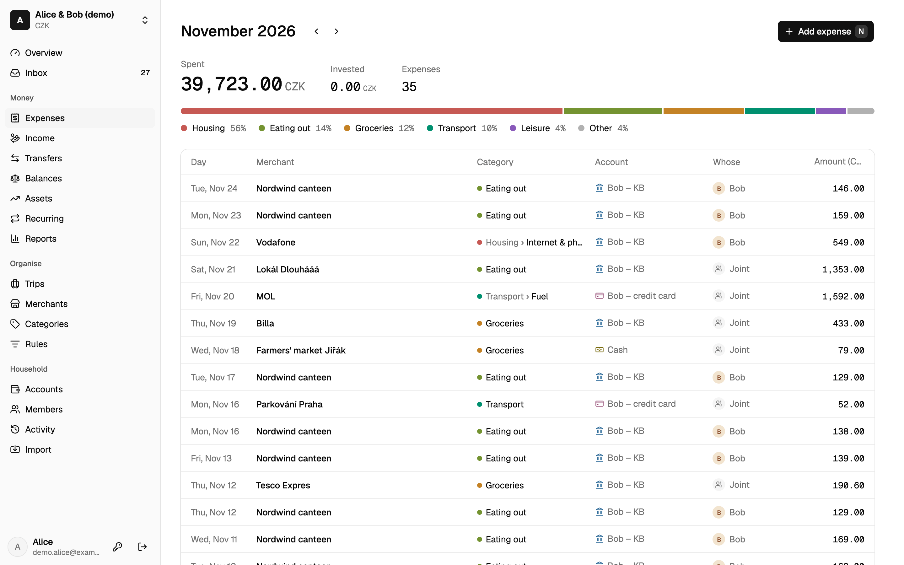
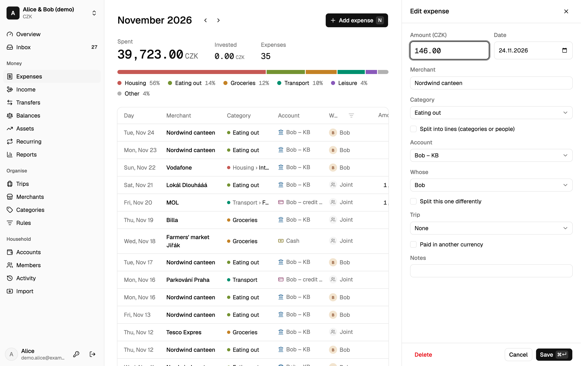
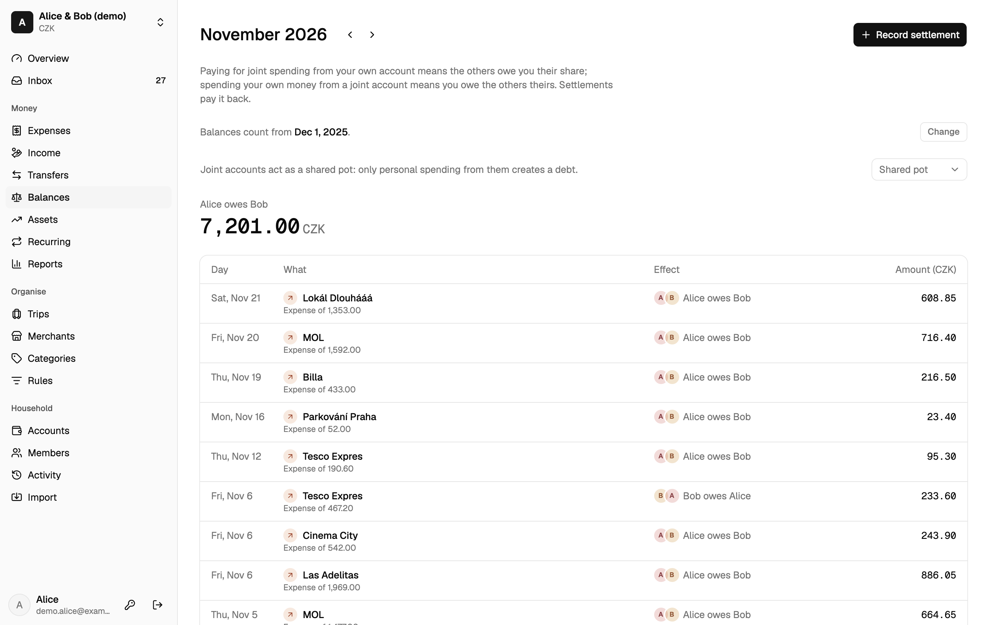
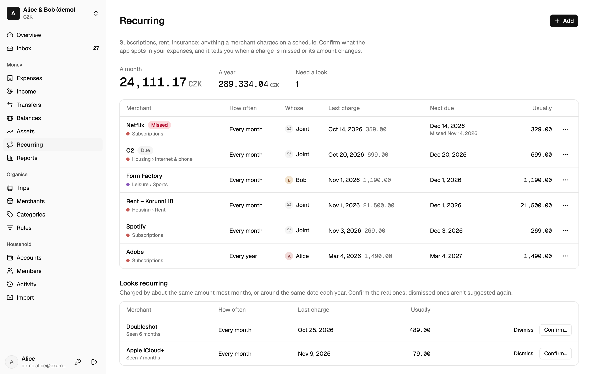
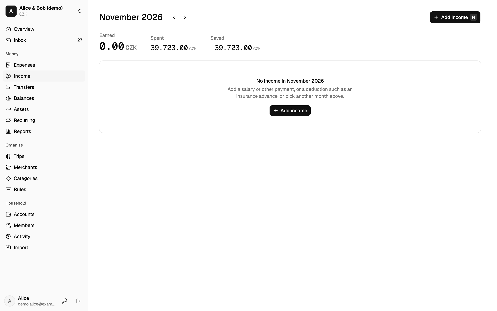
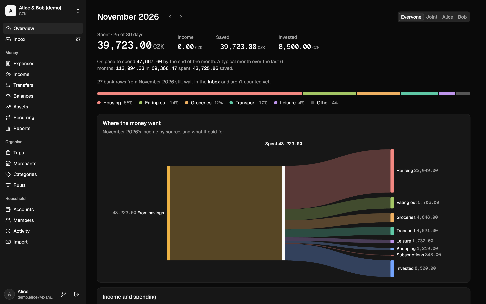
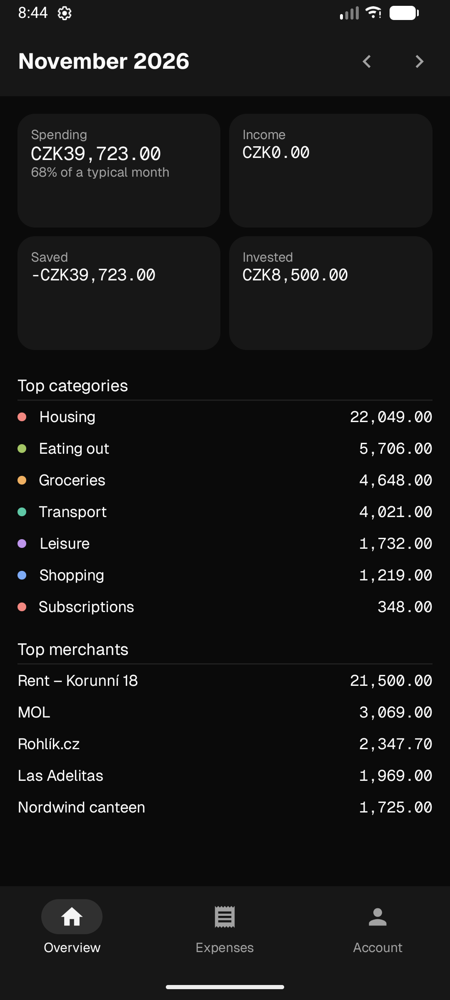
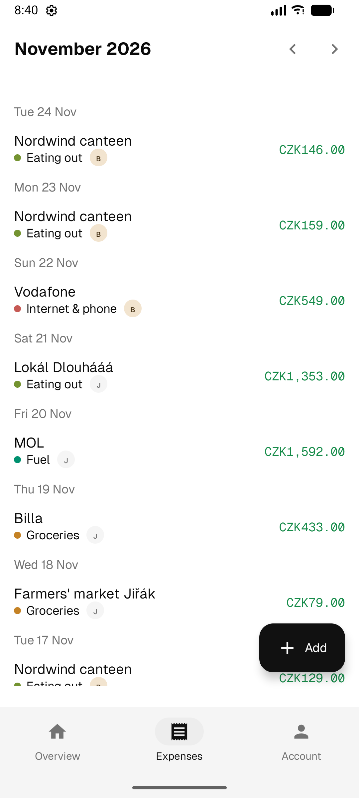
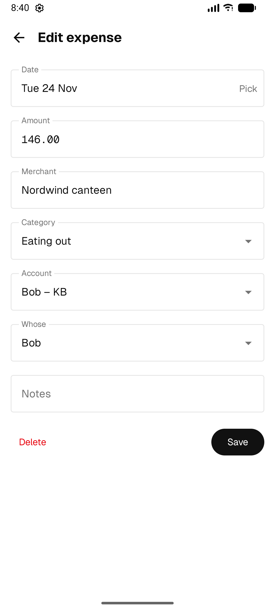

# Marketing screenshots

Captured from the local dev instance against the seeded demo household
(`demo.alice@example.com` / `demo-password`, "Alice & Bob (demo)", CZK,
November 2026). Made-up data only.

## Web

Web app at http://localhost:5173, 1440x900 @2x, logged in as Alice:

Overview — month summary, category bar, "Where the money went" sankey.

Inbox — pending bank rows with suggestions and chips.

Expenses — list and the side-panel editor.

Reports — yearly report with monthly bars, category and merchant breakdowns.

Balances — debts between members and split rules.

Assets — net worth, assets and liabilities.

Recurring — subscription radar (active, suggestions, missed/changed).

Income — gross, deductions, net.

 

Dark mode.

## Android

Debug build on an emulator (1080x2400), logged in as Alice:

 

Overview — month cards, top categories and merchants, light and dark.

 

Expenses — list grouped by day, light and dark.

Expense editor.
